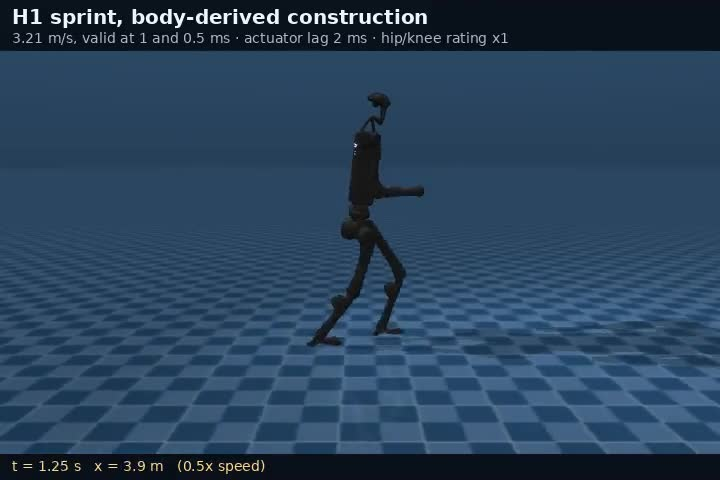
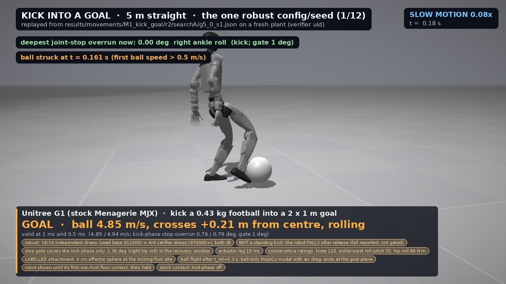
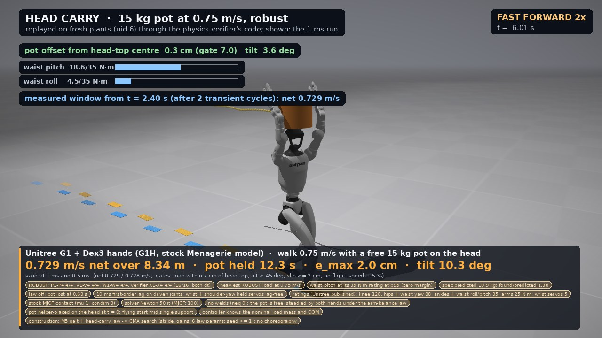
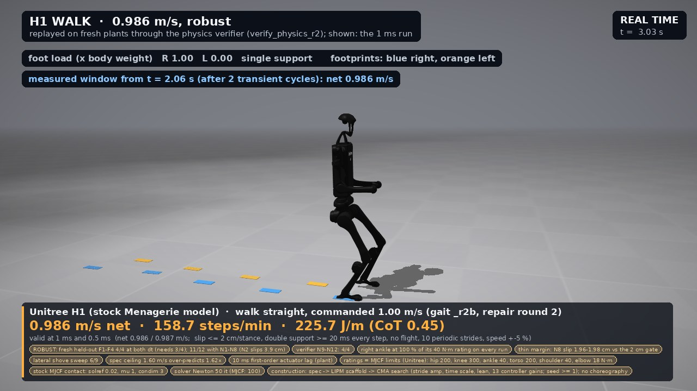

# Robotic movement

MuJoCo simulations in which humanoid robots (Unitree G1 and H1, Apptronik Apollo) find their own jumps, throws, kicks,
sprints, walks and carries from two inputs: a description of their own body and a physical goal. There is no human
motion data and no neural network anywhere in the pipeline. On a stock G1 the whole-body throw reaches a 22.6 m/s
release, the same sprint code runs the H1 at 3.22 m/s and a robot never used while building the method (Apollo) at
2.44 m/s, and both the G1 and H1 walk on their stock motors with a 10 ms actuator lag.

Write-up with video of every result: [rohitravi.com/projects/robotic-movement](https://www.rohitravi.com/projects/robotic-movement/).
Everything here is simulation; nothing has run on hardware.



## How a movement is constructed

1. **The body goes in.** Geometry, masses, joint limits and each motor's rated torque and speed, read from the
   manufacturer-derived MJCF and URDF. The per-robot specs, with a source for every number, are in `spec/*.yaml`.
2. **A goal goes in.** Release a ball fast, land it near a target, move the body forward, keep a load on the head.
   The goal says what has to happen, not how.
3. **A starting motion is derived from the body.** For example a deep crouch certified to be statically holdable, a
   wind-up chosen by which joints move the hand most given their motor limits, or a running limit cycle built from a
   stride model, inverse kinematics and inverse dynamics (`src/engine/sprint.py`).
4. **CMA-ES refines it on the real dynamics.** Torque knots on top of the starting motion are searched against the
   rated torque-speed envelope, a back-EMF brake, a first-order actuator lag and a set of validity gates (no foot
   slip, no non-foot ground contact, no fall, energy closure). A result counts only if it passes at both 1 ms and
   0.5 ms physics time steps, re-run on a freshly built plant.

A technique costs 2,400 to 38,400 simulated trials, minutes to a few hours on a desktop CPU. What is supplied by hand is
stated with each result: the broad structure of some starting motions ("wind up, then release"), the balance and
foot-placement controllers, and the simulator settings.

## Results

All numbers are read from the JSON files listed; the files are in this repo.

**Jumping** (`results/phase14/jump14_robust4.json`, `jump14_h1_robust4.json`). Seeded with the deep crouch derived
from the G1's own specification, the G1 jump lands under a feedback balance controller at both time steps in 5 of 6
seeds, with takeoff speeds of 2.5 to 3.6 m/s and a 35 to 42 cm crouch. The same procedure on the H1 lands 5 deep jumps at
2.1 to 2.3 m/s. A version that also keeps every joint off its mechanical stops and every foot from sliding during
push-off is still open. The box jump is open too: in the published rounds neither robot held a box of 0.20 m or more,
and the G1 landing tolerates forward speed only up to 0.3 m/s with ideal motors and none with a 10 ms lag.

**Throwing** (`results/construct_full/`). Asked only to release a 0.145 kg ball as fast as possible, the stock G1 at
the full budget of 38,400 trials produces whole-body throws of 19.6, 21.2 and 22.6 m/s over three seeds, all valid at
both time steps. Peak angular speed builds from 14 to 19 rad/s at the pelvis to 76 to 78 rad/s at the hand
(`emerged.peak_omega` in each file), a kinetic chain nobody wrote down. The arm on
its own tops out at 12.7 to 14.0 m/s (`throw_armonly_s*.json`). Weakening the arm or the legs reorganises the technique
rather than just slowing it (`throw_weakarm_*`, `throw_weaklegs_*`); those are what-if bodies, not robot capability.
The ball is a point mass on the palm and release speed equals palm speed.

**Throwing at a target** (`results/movements/M2_throw_target/`). Stock G1, motors held to published ratings with a
10 ms lag, ball free after release. The 10 m target is hit 0.12 m from the centre at 9.39 m/s
(`r2/d10_straight_soft_error_s26.json`) and on 14 of 16 randomised versions of the robot and start that the search
never saw (`critic/d10_straight_soft_error_s26.json`). At 15 m it hits on the nominal robot (0.42 m from the centre,
11.5 m/s) but only 7 of 16 randomised versions land inside 0.5 m, so it is a limit, not a result. The ball is held by
a labelled attachment until release, not a finger grip.

**Kicking** (`results/construct/kick_ball_s1.json`, `results/movements/M1_kick_goal/`). From one-foot support the G1
sends a football at 11.8 m/s, with peak speeds arriving in order pelvis, thigh, shank, foot (`emerged.peak_t`)
without that order being written anywhere; this
earlier kick was not re-checked under the later joint-stop and recovery gates. Aimed into a 2 m goal 5 m away under
rated torques and 10 ms lag, the ball goes in at 4.8 to 4.9 m/s on all 16 randomised versions tested
(`r2/searchA/g5_0_s1_confirm.json`). The robot falls after every kick, and only 1 of the 12 goal setups tried passes
reliably; the ankles hitting their joint stops are the binding limit.



**Running** (`results/sprint/`, `results/heldout/`). Same code on every body:

| robot | speed | conditions | file |
|---|---|---|---|
| Unitree H1 | 3.22 m/s | stock body and ratings, 2 ms lag, stiffer foot contact (solref 0.004; at the MuJoCo default this controller finds no gait) | `ladder_H1_lag2ms_extrap.json` |
| Apptronik Apollo | 2.44 m/s | never used while building the method; joint speed ratings are not published and were assumed; joint damping removed and sole contact set to the project protocol | `ladder_Apollo_heldout_lag2ms.json` |
| H1, ankles x3 (what-if) | 4.6 m/s | modified body | `ladder_H1_C_ank3_climb_sg0.1_sd1.json` |
| H1, ankles x4 (what-if) | 5.1 m/s | modified body | `ladder_H1_C_ank4.0_climb_sg0.1_sd1.json` |

With the body-derived starting motion removed and everything else identical, the same search on Apollo never found a
valid gait in 1,441 evaluations on either of two seeds (`results/heldout/ablation_Apollo_lag2ms_v1.0_A_s*.json`). The
what-if rows show where the H1 is limited: at its stock 40 N m rating the ankle cannot push off through the foot.

**Walking** (`results/movements/M5_walking/`). Periodic walks with double support on every step, no sliding, stock
bodies and published ratings, 10 ms lag: G1 at 0.722 m/s and H1 at 0.986 m/s
(`G1/search_v0.75_r2b_valR2.json`, `H1/search_v1.0_r2b_valR2.json`). They pass 14 of 16 and 15 of 16 held-out
disturbances (heavier or lighter limbs, start errors, slower motors, lower friction, shoves). The controller is given
the true centre of mass, and sideways push recovery works only in some phases of the step, so it is not claimed.

**Carrying on the head** (`results/overnight/Q1/lag_maxima.json`, `results/movements/M6_walking_headcarry/`). An
arm-balance law built from the arm's own geometry and motor limits keeps a free 32 kg box on a standing G1's head for
10 s with a 10 ms lag; with the law switched off it drops in under a second. Walking at 0.75 m/s, a free 15 kg pot stays
within 2 cm of the head top over 8.3 m and passes all 16 tested disturbances
(`search/pot_15kg_v0.75_s1_rFrob_validation.json`); 20 kg is valid but passes only 12 of 16.



**A bag too heavy to lift** (`results/luggage/mechanism_S3.json`). Given a 45 kg wheeled bag and three ways to move it,
the search tips it onto its wheels and leans it against the robot's own hips (up to 370 N through that contact), moving
it 0.35 m. The hands are attached to the handle rather than gripping it.

**Grasping** (`results/atlas/j27_stress_wrap.json`). A real finger wrap of a tool handle with the G1's Dex3 hand,
followed by a force-controlled wipe, holds in 6 of 10 stress tests. Every other hold in the project is a labelled
attachment.



## What did not hold up

Claims I made earlier and withdrew are not restated as results here. In particular, I had said the top running speeds
were predicted from each robot's specification before any search. That is withdrawn: the ceiling model in
`src/engine/sprint_ceiling.py` had a sign error and relied on a step-rate cap imposed by hand. The speeds the search
found are real; the "predicted first" story was not. The spec-derived predictors name the binding joint correctly in
several cases but miss capacity magnitudes by 1.4 to 2.3x in both directions.

## How to run

Python 3.12, CPU only. The results above were produced with MuJoCo 3.2.7.

```bash
python -m venv .venv && source .venv/bin/activate
pip install -r requirements.txt
sh scripts/get_models.sh          # clones MuJoCo Menagerie into models/ and adds the palm-site model copies
python -m pytest tests src/movement_discovery/tests
```

The movement scripts are run from `src/`, for example:

```bash
cd src
python engine/construct.py throw 0 2400 16                   # whole-body throw, 2,400 iterations x pop 16
python engine/sprint.py ladder H1 1.0,1.5,2.0,2.5,3.0 60 16 8  # sprint speed ladder (SPRINT_LAG=0.002 for 2 ms lag)
python engine/walk.py search G1 0.75 40 16 8 1                 # walking search
python engine/walk_headcarry.py search pot 15 40 16 8 1        # walking with a pot on the head
python -m engine.kick_goal search g5_0 1                       # kick into the 5 m goal
python engine/throw_target.py search d10_straight 26           # throw at a 10 m target
SPRINT_LAG=0.002 python heldout/ablation.py Apollo 1.0 A 0     # Apollo with the body-derived start removed
python luggage.py search S3                                    # the 45 kg bag
```

Each script's docstring lists its options, environment variables and output path. Set `MENAGERIE_DIR` if the models
live somewhere other than `models/mujoco_menagerie`. Before running anything on Apollo or the Booster T1, run
`python heldout_onboard.py` once; it writes the renamed model copies those robots need.

## Repo layout

```
spec/                  per-robot specs (G1, H1, Apollo, T1) with sources; palm-site MJCF copies; strength and validation sources
src/engine/            the current construction engine: plant, tasks, sprint, walk, head carry, throw/kick to target, box jump, rendering
src/tasks/             task definitions (jump, throw, reach, impact, wipe)
src/heldout/           held-out robot onboarding checks and the starting-motion ablation
src/movement_discovery/  a scenario bank of 96 movement programs over the same engine, with its own tests
src/*.py               earlier phases: the jump analyses, pose-bank certification, throw campaigns, head carry, luggage, verifiers
tests/                 plant, geometry and measurement tests
results/               the result files the numbers above come from
figures/               stills from the rendered replays
```

## Data and models

- **Robot models** are not vendored. `scripts/get_models.sh` clones
  [MuJoCo Menagerie](https://github.com/google-deepmind/mujoco_menagerie) at the commit used here (8161bba) into
  `models/mujoco_menagerie` and copies in `spec/g1_hands_palm/*.xml` and `spec/h1_palm/*.xml`, which are the Menagerie
  G1-with-hands and H1 models with one added palm site. The Unitree models are BSD-3-Clause (Unitree Robotics; the
  notice is reproduced in `spec/UNITREE_LICENSE.txt`), Apollo and T1 are Apache-2.0.
- **Human motion** appears only in the jump comparison baseline (`src/mocap_baseline.py`), which retargets LAFAN1
  clips with GMR. Neither is included; get [LAFAN1](https://github.com/ubisoft/ubisoft-laforge-animation-dataset) and
  [GMR](https://github.com/YanjieZe/GMR) and point `MOCAP_BASELINE_DIR` at them. None of the other pipelines load
  human data (`src/movement_discovery/tests/test_no_demonstration_data.py` checks this).
- **Large intermediate files** (pose banks, trajectories, replay caches, videos) are not included. They are written
  by the scripts that use them, for example `src/rebuild_bank.py` for the certified pose bank.

## License

MIT for the code, see `LICENSE`. Robot models keep their upstream licenses.
